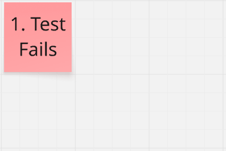
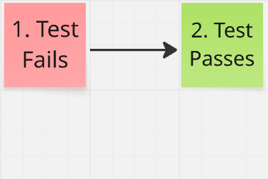
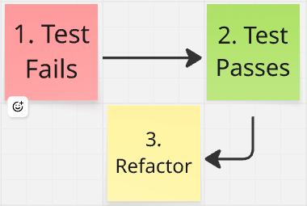
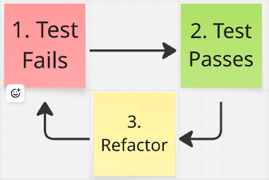
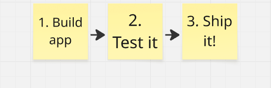
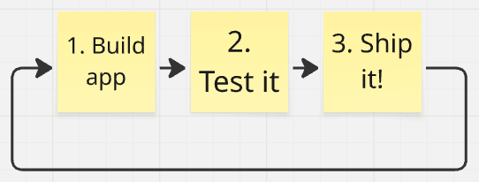

# Test-Driven Development

__Test-Driven Development__, or __TDD__ is the most important technique I've learned in software engineering. My personal experience is that codebases created by largely following TDD are simpler, have fewer bugs, and are more pleasant to work in compared to those without TDD. This doesn't mean other aspects of good software craftsmanship aren't also important.

Code quality is an important factor in effective software delivery. High quality code is important because it allows engineers to add new features quickly and confidently. It allows products to respond to change, to adapt to new user workflows or system integrations.

## What is it?

TDD is a 3-step software development practice. A simple way to remember the 3 steps is "__Red-Green-Refactor__".

First, you create a new automated test that describes some expected behavior of the code. Behaviors are just the various ways your software behaves given different inputs. 

Here's an example of an expected behavior: _"When the user types an invalid character in the field, it should indicate an error by applying a red outline"_. 

At this point, you run the test. However, the expected behavior doesn't exist, so the test will fail. In TDD a failing tests is often called a "red" test. 

After seeing the test fail as expected, you write some code to implement the function, for example adding an error state to a text field. 

Then you run the test again to verify it passes. A passing test is often called "green".

Finally, when every automated test passes, there is an opportunity to refactor the code. Some common ways to refactor the code include replacing duplicated code with a function call, or renaming a variable to be more descriptive.

After you have (optionally) refactored the code, it is time to work on the next incremental feature by writing a new test.

As you can see, each of the 3 steps follows one of the others, forming a __cycle__. When developing an application, applying TDD means to repeat the cycle over and over and over again. 

__Red-Green-Refactor__.

## Why Test?

The purpose of TDD is to ensure that test coverage remains as high as possible. But test coverage isn't just a metric for its own sake. Let’s step back and ask: why is test coverage important?

What really matters at the end of the day is good software. In other words, the app should work! To make sure it works, we test it out. 

A long time ago, the lifecycle of a software project generally resembled this diagram. A team would build a piece of software, test it out, then ship it.

Unfortunately, modern software delivery is not so simple!

The reality for nearly all software is that it's never done; it is always being tweaked and improved. Development is an iterative process. Top software companies like Amazon and Google push new updates to their flagship products daily or even multiple times a day. There is a term for this: [__Continuous Delivery__](https://martinfowler.com/books/continuousDelivery.html).

When developing iteratively, tension is created. We want frequent changes to the code, and we want to deliver quickly, but we also want the app to work. Some teams accept the risk of breaking things, and simply don't test. Other teams pay some slow, error-prone humans to test each version of the app before it gets shipped. The third option is comprehensive __automated tests__. If the goal is __delivering quickly _and_ confidently__, the best way to achieve this is with automated test coverage.

## Invest in Tests

One argument against TDD is that writing automated tests takes too long, or it is too hard. I won't argue that it takes time and can be difficult, especially at first. But the other side of the equation deserves exploring. When we invest in tests, what do we get for our efforts?

First, as I mentioned earlier, your automated tests replace testing by hand. In many cases __manual testing can be eliminated__ by comprehensive tests. That's probably reason enough to write automated tests.

Another major return on investment comes in the form of __developer confidence__. This is somewhat hard to convey if you haven't experienced it, but it's undeniable for many who have first-hand experience on well-tested codebases. In short, having tests gives you freedom to [refactor](refactoring.md) the code. A great deep dive on this subject is Matthew Parker's [Why TDD](https://blogs.vmware.com/tanzu/why-tdd/).

## Test First

It's possible to write the tests after the code, and I think many people do that. But to me, when I think about what makes a test good, the idea of writing them first naturally follows.

The main thing a good test should do is pass when things work as expected, and fail when they don't work as expected. It sounds obvious but it's worth saying. As the author of a good test, a developer needs to verify both of these scenarios. In other words, they must try the test on 2 different versions of the code and see that the test passes under the expected condition, and fails under incorrect conditions.

I want to emphasize this point: __if a test has never failed, it's not a good test__. I have encountered many tests that look correct at first glance but never fail due to some bug in the test. 

So a test should fail. The only remaining question is, at what point in development should the test fail? 

* The test fails __first__. Congratulations, you're doing TDD! 
* The implementation comes first, then a test which passes. Then __at the end__, the implementation is temporarily removed to verify the test will fail. This is still effective, but it does add an extra step.

For me, the choice is clear. Only writing the test __first__ gives me the confidence I need while avoiding extra work. That's why I TDD!

## Test for design

Another benefit of writing a test first is that it forces you to confront domain and design questions upfront. Before you write any code, you __must__ define what exactly it is you're trying to accomplish, and how the code will be invoked. This naturally leads to more user friendly APIs in my experience.

## Learn More About TDD

### Resources

* [Test-Driven Development - Martin Fowler](https://martinfowler.com/bliki/TestDrivenDevelopment.html)
* [Test-Driven Development By Example - Kent Beck (Amazon)](https://www.amazon.com/Test-Driven-Development-Kent-Beck/dp/0321146530)